  
  
  

 

## See it live

My portfolio at **[heek1.github.io](https://heek1.github.io/)** is the fastest way to see what I do: a live map of my stack, eyes that follow your cursor, the projects below with "how it works" views, and a console where you can call me as an API.

## About

Full-stack developer with a backend focus. I design APIs, data models and services on **ASP.NET Core** and **Node.js**, build the interfaces on **React** and **Angular**, and ship them in containers. Lately my work is about bringing **LLMs into real backend systems** — with the checks, tests and observability that make them trustworthy.

I've led several team projects. The rule I keep in all of them: build exactly what the spec asks for, with minimal, predictable code that is easy to review.

<table>
  <tr>
    <td width="150"><b>Education</b></td>
    <td>

Artificial Intelligence, 2nd year — [TUKE](https://www.tuke.sk), Košice &nbsp;·&nbsp; Software Development, graduated with honours — [IT-Step Academy](https://itstep.org)

</td>
  </tr>
  <tr>
    <td width="150"><b>Hackathons</b></td>
    <td>

Magna Hackathon 2026 &nbsp;·&nbsp; HackKosice 2026

</td>
  </tr>
  <tr>
    <td width="150"><b>Certified</b></td>
    <td>

Cisco Networking Academy — C, C++ and Python Essentials

</td>
  </tr>
</table>

## Tech stack

<table>
  <tr>
    <td width="150"><b>Languages</b></td>
    <td>

       

</td>
  </tr>
  <tr>
    <td width="150"><b>Backend</b></td>
    <td>

     

</td>
  </tr>
  <tr>
    <td width="150"><b>Frontend</b></td>
    <td>

  

</td>
  </tr>
  <tr>
    <td width="150"><b>Data</b></td>
    <td>

  

</td>
  </tr>
  <tr>
    <td width="150"><b>DevOps & tools</b></td>
    <td>

    

</td>
  </tr>
  <tr>
    <td width="150"><b>Exploring</b></td>
    <td>

          

</td>
  </tr>
</table>

## Featured work

<table>
  <tr>
    <td width="46%" valign="top">
      
</td>
    <td valign="top">
      <h3><a href="https://github.com/Heek1/prooffit">ProofFit</a></h3>
      
Compares a resume with a job posting and backs every verdict with evidence — a line of the resume or code in the candidate's public GitHub. The LLM only proposes; plain code checks each citation and computes the score.

      
<code>.NET 10</code> <code>React 19</code> <code>TypeScript</code> <code>PostgreSQL</code> <code>Gemini</code> <code>OpenTelemetry</code>

      
<a href="https://prooffit.onrender.com"><b>Live demo</b></a> &nbsp;·&nbsp; <a href="https://github.com/Heek1/prooffit">Source</a>

</td>
  </tr>
  <tr>
    <td width="46%" valign="top">
      
</td>
    <td valign="top">
      <h3><a href="https://github.com/Heek1/AI-Prompt-Management-System">Prompt Manager</a></h3>
      
Self-hosted home for a team's AI prompts: versions with word-level diffs, evals that gate every release, guarded promotion to production, and an API that serves the tested version to other apps.

      
<code>ASP.NET Core 10</code> <code>EF Core</code> <code>PostgreSQL</code> <code>Claude</code> <code>Docker</code> <code>Playwright</code>

      
<a href="https://prompt-manager-bt5r.onrender.com"><b>Live demo</b></a> &nbsp;·&nbsp; <a href="https://github.com/Heek1/AI-Prompt-Management-System">Source</a>

</td>
  </tr>
  <tr>
    <td width="46%" valign="top">
      
</td>
    <td valign="top">
      <h3><a href="https://github.com/Heek1/magna-hackathon-2026">OEE Engine</a></h3>
      
<b>Magna Hackathon 2026.</b> Phone-first app for an assembly line: finds repeating production losses, predicts the next stop and names the fix, with an AI assistant that answers only from line data.

      
<code>Python</code> <code>FastAPI</code> <code>React</code> <code>TypeScript</code> <code>Gemini</code> <code>PWA</code>

      
<a href="https://oee-engine.onrender.com/"><b>Live demo</b></a> &nbsp;·&nbsp; <a href="https://github.com/Heek1/magna-hackathon-2026">Source</a>

</td>
  </tr>
</table>

## Certifications

| Course | Issuer | Completed |
|---|---|---|
| C++ Essentials 1 | Cisco Networking Academy | Apr 2025 |
| C Essentials 1 | Cisco Networking Academy | May 2025 |
| Python Essentials 1 | Cisco Networking Academy | May 2025 |
| C++ Essentials 2 | Cisco Networking Academy | Sep 2025 |
| Python Essentials 2 | Cisco Networking Academy | Sep 2025 |

## GitHub activity

  
  

